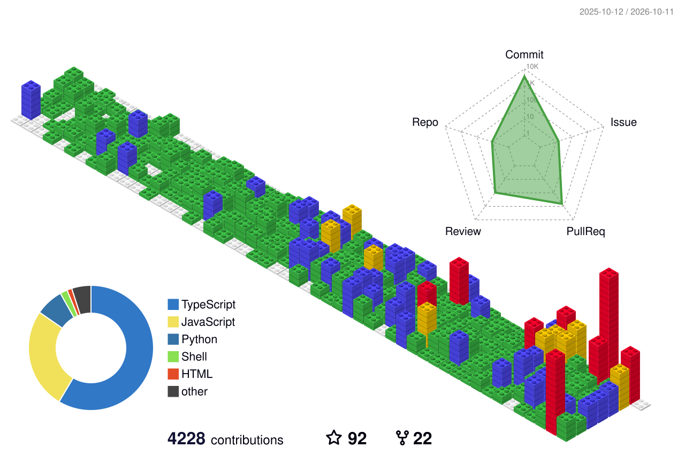

# Francisco Paiva Knebel

Software engineer building enterprise applications and distributed systems at [Dawntech](https://dawntech.dev). Coding professionally since 2014, with hands-on work in backend engineering, cloud architecture and technical leadership.

Computer Engineer and M.Sc. in Computer Science from [UFRGS](https://ufrgs.br), Brazil. My research focuses on Digital Twins, Computer Networks, and Cloud and Edge Computing.

[Portfolio](https://franciscoknebel.com) · [Portfólio em português](https://franciscoknebel.com/pt/) · [LinkedIn](https://www.linkedin.com/in/francisco-knebel-295493111/) · [Professional contact](https://knebel.inf.br)

## Selected projects

| Project                     | What it does                                                                                     | Explore                                                                                                                          |
| --------------------------- | ------------------------------------------------------------------------------------------------ | -------------------------------------------------------------------------------------------------------------------------------- |
| **gnome-provider-limits**   | GNOME Shell extension showing session and weekly rate limits for AI coding CLIs in the top bar.  | [Code](https://github.com/FranciscoKnebel/gnome-provider-limits) · [Website](https://gnome-provider-limits.franciscoknebel.com/) |
| **ngx-translate-check**     | CLI that detects missing and unused translation strings in Angular projects using ngx-translate. | [Code](https://github.com/FranciscoKnebel/ngx-translate-check)                                                                   |
| **UFRGS Scholarship Board** | Platform built at IDE Junior Enterprise and adopted as UFRGS's official scholarship board.       | [Website](https://www.ufrgs.br/bolsas/) · [Project context](https://franciscoknebel.com/projects/ufrgs-bolsas/)                  |
| **nginx-reverseproxy**      | Multidomain reverse proxy configuration for isolated Node.js applications with HTTPS.            | [Code](https://github.com/FranciscoKnebel/nginx-reverseproxy)                                                                    |

## Research

Selected work on deploying Digital Twins across cloud and edge environments:

- [A study on cloud and edge computing for the implementation of digital twins in the oil & gas industries](https://www.researchgate.net/publication/371336015), Computers & Industrial Engineering, 2023.
- [Designing and implementing digital twins with cloud and edge computing: challenges and opportunities](https://lume.ufrgs.br/handle/10183/276593), M.Sc. dissertation, UFRGS, 2024.

[All publications](https://franciscoknebel.com/publications/) · [Google Scholar](https://scholar.google.com/citations?user=_RHtqxIAAAAJ) · [ORCID](https://orcid.org/0000-0003-3895-2755) · [Lattes](http://lattes.cnpq.br/5190590589102587) · [ResearchGate](https://www.researchgate.net/profile/Francisco-Knebel)

## Community and organizations

- [Dawntech](https://dawntech.dev): current engineering work and technical leadership.
- [Open Digital Twin](https://github.com/Open-Digital-Twin): Digital Twin research and open-source projects.
- [Networks UFRGS](http://networks.inf.ufrgs.br): computer networking research.
- [IDE Junior Enterprise](https://www.idejr.com.br): previous work in development, project management and quality.

GitHub contribution calendar

Activity in public repositories is one part of my work; it does not describe all professional projects or experience.

<picture>
  <source media="(prefers-color-scheme: dark)" srcset="profile-3d-contrib/profile-night-view.svg">
  
</picture>

## Website source

This repository also contains my bilingual Astro portfolio. See the [maintenance guide](docs/maintenance.md) for setup, validation, content editing and deployment.
